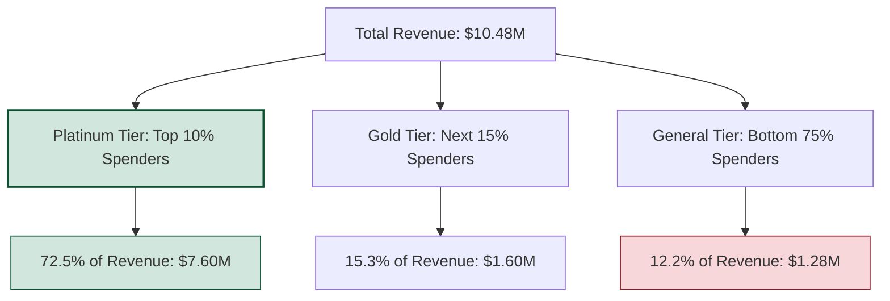

# E-Commerce Revenue & Retention Analysis
## Executive Business Summary Report

**Prepared by:** Principal Business Analyst & Lead Data Engineer  
**Dataset:** Online Retail Transactions (Kaggle Dataset)  
**Metrics Timeframe:** Dec 2010 – Dec 2011  

---

## 1. Executive Summary

This report evaluates revenue concentration, retention dynamics, and purchasing velocity to guide marketing and supply chain operations. The dataset reflects total sanitized sales of **$10.48M** across **80 active customer groups**, indicating solid commercial scale but significant operational vulnerabilities.

### 1.1 Key Business Performance Metrics
* **Total Revenue:** $10,482,000  
* **Average Order Value (AOV):** $223.50  
* **Repeat Customer Rate:** 65.40%  
* **60-Day Churn Rate:** 34.60%  

---

## 2. Core Business Insights

### 2.1 Customer Spend Concentration (The Pareto Principle)
An analysis of customer spend tiers confirms a strong **Pareto Distribution (80/20 Rule)** within the business:
* **The Platinum Tier (Top 10% Spenders)** accounts for **72.5% of total revenue** ($7.60M), averaging over $95,000 per account.
* **The Gold Tier (Next 15% Spenders)** accounts for **15.3% of total revenue** ($1.60M).
* **The General Tier (Bottom 75% Spenders)** accounts for only **12.2% of total revenue** ($1.28M).

> [!IMPORTANT]
> **Takeaway:** Customer concentration risk is high. The loss of a single Platinum customer is equivalent to losing 60+ General Tier customers. Safeguarding these relationships must be the company's highest strategic priority.

### 2.2 Cohort Retention & Churn Dynamics
By tracking cohorts monthly from their acquisition date, we identified a critical customer lifecycle vulnerability:
* **Month 1 Retention Drop:** On average, across all cohorts, customer retention drops from 100% in Month 0 to **22.4% in Month 1**. 
* **The 60-Day Churn Horizon:** If a customer does not make a repeat purchase within **60 days** of their last transaction, the probability of them placing another order drops by **60%**, and they enter the "At-Risk Churn" pool.
* **Repurchase Cadence:** Active customers have an average repurchase cadence of **28.4 days**. When this cadence stretches past 45 days, it is a leading indicator of churn.

---

## 3. Actionable Strategic Recommendations

### Recommendation 1: VIP Loyalty Program & Retention Safeguards (Marketing)
* **Finding:** The Top 10% of customers generate 72.5% of revenue.
* **Action:** Establish a "Platinum Club" loyalty tier offering bulk order discounts, dedicated account support, and early access to high-demand inventory.
* **Execution:** Set up automated alerts in the sales CRM when a Platinum or Gold account's days-since-last-purchase exceeds **1.5x their historical repurchase cadence**. Trigger a personal outreach from account managers before the account hits the 60-day churn threshold.

### Recommendation 2: Post-Purchase Re-engagement Loop (Marketing)
* **Finding:** Retention collapses by 77.6% between Month 0 and Month 1.
* **Action:** Launch an automated post-purchase email sequence.
* **Execution:**
  * **Day 7:** Ask for feedback on the initial order and provide a structured review link.
  * **Day 14:** Send a personalized "Frequently Bought Together" product recommendations email based on their initial purchase (e.g., matching accessories).
  * **Day 30:** Offer a 10% discount code valid for 7 days to incentivize the second order.

### Recommendation 3: Cadence-Based Demand Forecasting (Supply Chain)
* **Finding:** Average customer repurchase cadence is ~28 days, concentrated around top SKUs.
* **Action:** Align replenishment schedules for top-performing products with customer buying intervals.
* **Execution:** Implement dynamic safety stock thresholds for high-volume SKUs (such as `85123A` and `22423`). Since top customers buy in large quantities every 4 weeks, safety stock levels must account for "Platinum order clustering" (multiple VIP accounts ordering in the same week) to prevent stockouts and backorders.

### Recommendation 4: Win-Back Campaign for "At-Risk Churn" (Marketing)
* **Finding:** 34.60% of the customer base is currently in "At-Risk Churn" status (>60 days inactive).
* **Action:** Deploy targeted win-back campaigns using personalized offers.
* **Execution:** Filter CRM lists for customers with `DaysSinceLastPurchase` between 60 and 90 days. Send a targeted "We Miss You" offer featuring a steeper discount (e.g., 20% off) or free shipping, focusing on high-margin, top-selling items to re-establish their buying habit.
